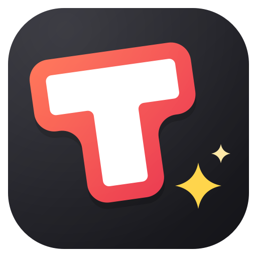
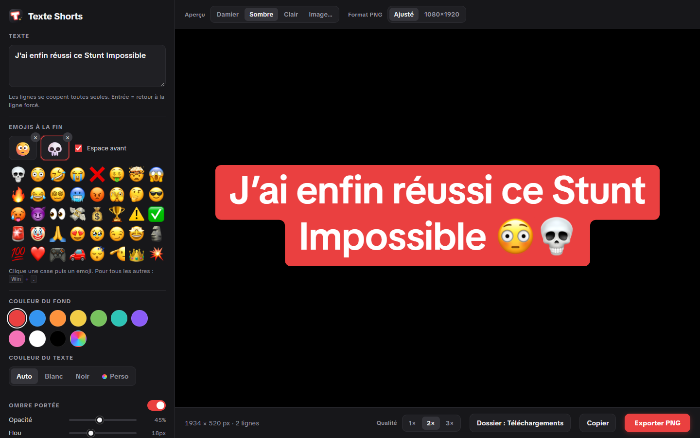
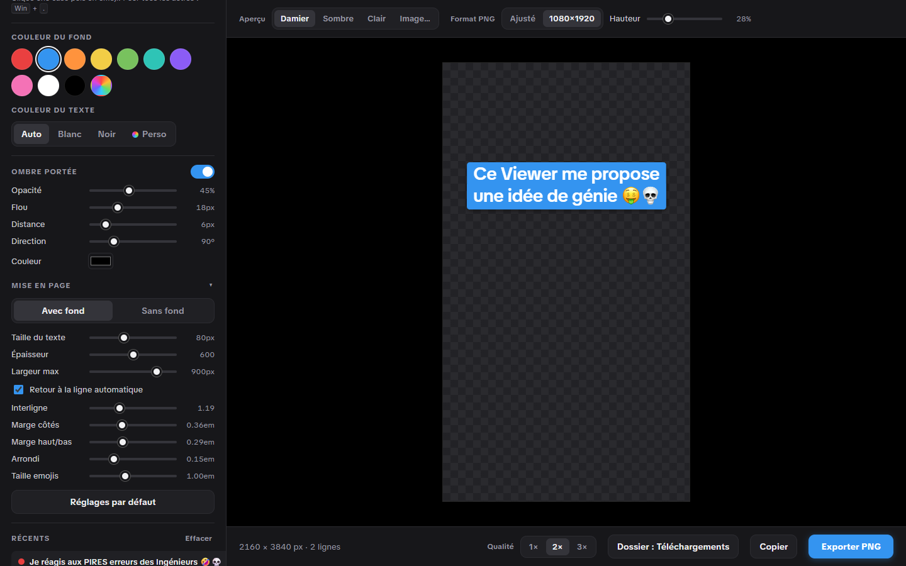
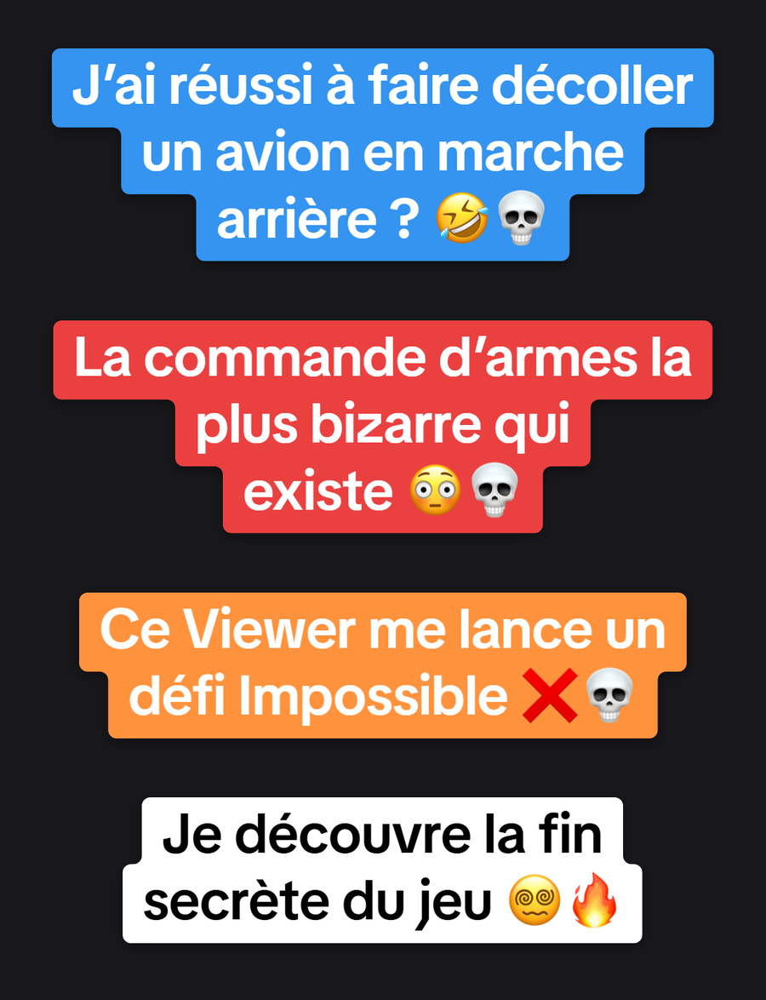

<div align="center">



# Texte Shorts

Crée tes titres **façon TikTok** (fond coloré, emojis Apple, petite ombre portée) et exporte-les en **PNG transparent** pour tes Shorts.

[**⬇ Télécharger pour Windows**](https://github.com/StundZow/texte-shorts/releases/latest/download/TexteShorts.zip) · [Releases](https://github.com/StundZow/texte-shorts/releases)



</div>

## Ce que ça fait

Texte Shorts s'adresse aux créateurs qui montent leurs vidéos verticales sur PC mais veulent garder le titre « signature » de TikTok : le texte blanc sur son bloc rouge (ou bleu, orange…), un bloc par ligne, coins arrondis, et deux emojis à la fin.

Tu tapes ton titre, tu choisis la couleur et tes emojis, et l'appli sort un PNG transparent prêt à poser sur ta timeline (Premiere, CapCut, DaVinci, peu importe).

## Pourquoi pas juste écrire le titre dans TikTok ?

Parce que le texte ajouté dans l'appli TikTok reste dans TikTok : impossible de le récupérer pour YouTube Shorts, Reels ou ton montage sur PC. Le refaire à la main dans un logiciel de montage, c'est retrouver la police, recaler les marges et redessiner les raccords arrondis entre les lignes, à chaque vidéo. Ici, c'est un champ texte et un bouton.

## Fonctionnalités

- 🔤 **La vraie police TikTok** (TikTok Sans), avec les proportions mesurées sur de vrais titres : interligne, marges, arrondis, raccords entre les lignes
- 😳 **Emojis Apple**, comme sur iPhone : une grille de favoris (💀 😳 🤣 😭 ❌…) ou n'importe quel emoji avec <kbd>Win</kbd> + <kbd>.</kbd>, toujours collés au dernier mot
- 🎨 **Couleurs TikTok** (rouge, bleu, orange…) ou une couleur perso, avec un texte blanc ou noir choisi automatiquement selon le fond
- 🌫️ **Ombre portée réglable** : opacité, flou, distance, direction, couleur
- 📐 **Deux formats d'export** : recadré au plus juste, ou **1080×1920** avec le titre déjà placé à la bonne hauteur (posé sur ta timeline, il est aligné)
- 🔍 **Qualité 1×, 2× ou 3×** pour rester net même en 4K
- 💾 **Export en un clic** (<kbd>Ctrl</kbd>+<kbd>S</kbd>), copie dans le presse-papiers, glisser-déposer de l'aperçu vers un dossier, ou enregistrement direct dans le dossier de ton choix
- 🖼️ **Aperçu sur ta vidéo** : glisse une capture de ton Short derrière le titre pour juger du rendu
- 🕘 **Titres récents** et réglages mémorisés d'une session à l'autre

<div align="center">

&nbsp;&nbsp;

</div>

## Prise en main

1. [Télécharge `TexteShorts.zip`](https://github.com/StundZow/texte-shorts/releases/latest/download/TexteShorts.zip) et dézippe-le où tu veux (Documents, Bureau…).
2. Double-clique **Lancer Texte Shorts.bat** : l'appli s'ouvre dans sa propre fenêtre, et un raccourci **Texte Shorts** avec l'icône apparaît dans le dossier. Épingle-le à la barre des tâches ou glisse-le sur le Bureau pour la suite.
3. Tape ton titre, choisis tes emojis et ta couleur, règle l'ombre.
4. Clique **Exporter PNG** (ou glisse l'aperçu dans un dossier) et pose le PNG sur ta vidéo.

*(Rien à installer : il faut juste Google Chrome ou Microsoft Edge, déjà présent sur Windows 10 et 11.)*

## Comment ça marche

C'est une page web locale ouverte en mode application : tout le rendu se fait dans un `<canvas>` sur ton PC, rien n'est envoyé nulle part. La police TikTok Sans (licence libre SIL OFL, publiée par TikTok) est embarquée dans l'appli. Les emojis Apple viennent du CDN jsDelivr ([iamcal/emoji-data](https://github.com/iamcal/emoji-data)) : il faut donc une connexion internet pour eux, et hors ligne l'appli bascule sur les emojis Windows.

Le fond suit le même principe que TikTok : un rectangle par ligne, centrés, et quand deux lignes n'ont pas la même largeur, la plus large recouvre la zone où elles se chevauchent. Chaque angle du contour, saillant ou rentrant, est ensuite arrondi. Les apostrophes deviennent typographiques (’) comme sur iPhone, et une espace insécable empêche un « ? » ou les emojis de partir seuls à la ligne.

## Lancer depuis les sources

Pas de build : clone le dépôt et double-clique `Lancer Texte Shorts.bat` (ou ouvre `index.html` dans Chrome).

Pour régénérer l'icône après une retouche du dessin :

```bash
pip install PySide6
python tools/make_icon.py
```

## Publier une nouvelle version (pour les mainteneurs)

```bash
python release.py 1.1 "Description des changements"
```

Ce script prépare `TexteShorts.zip`, tague la version et publie la release sur GitHub. Nécessite [GitHub CLI](https://cli.github.com/) authentifié.
